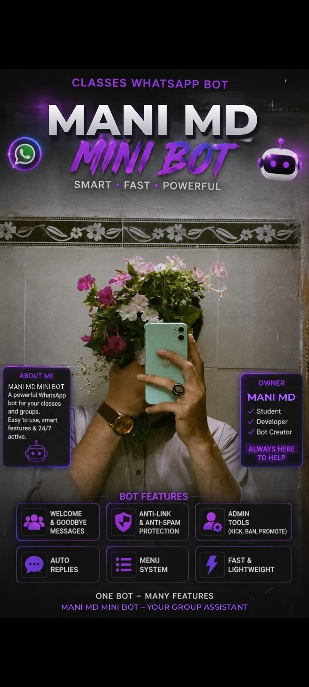

<div align="center">


<a href="https://github.com/YOUR_GITHUB_USER/mani-mini-bot">
  
</a>

<br/>



### ✅ 𝗠𝗔𝗡𝗜 𝗠𝗜𝗡𝗜 𝗕𝗢𝗧


</div>

---

## 🌐 Official Links

<div align="center">

[](https://whatsapp.com/channel/0029Vb60cZWI1rcauQ1lpn0Y)
[](https://wa.me/923317568033)
[](https://t.me/Mani375)

</div>

---

## 🚀 Deploy

<div align="center">

[](https://railway.com/new)
[](https://vercel.com/new/clone?repository-url=https://github.com/YOUR_GITHUB_USER/mani-mini-bot)
[](https://heroku.com/deploy?template=https://github.com/YOUR_GITHUB_USER/mani-mini-bot)

</div>

**Steps**

1. Is repo ko apne GitHub account me upload / fork karein (files repo ki root me hon).
2. Ek **private** repo banayein sessions ke liye, jaise `mani-sessions`.
3. Railway me *New Project → Deploy from GitHub repo* chunein aur neeche wale Variables daalein.
4. Deploy hone ke baad **Settings → Networking → Generate Domain** karein.
5. Domain kholein → apna number likhein → **Pairing Code** milega → WhatsApp me *Linked Devices → Link with phone number* me code daalein.

> ⚠️ **Vercel** par bot khud nahi chalta, wahan sirf **pairing website** khulti hai. Bot **Railway / Katabump / Heroku** par chalta hai.
>
> **Vercel setup:** Vercel → Settings → Environment Variables me `BACKEND_URL` = apna Railway URL (jaise `https://your-app.up.railway.app`) daalein, phir Redeploy karein. Website Vercel ke link par khulegi aur pairing Railway wale bot se hogi.

---

## ⚙️ Settings (Environment Variables)

| Variable | Zaroori | Description |
|---|:---:|---|
| `GITHUB_TOKEN` | ✅ | GitHub Personal Access Token (`repo` permission) |
| `GITHUB_REPO` | ✅ | `username/mani-sessions` (sessions wali private repo) |
| `GITHUB_BRANCH` | ➖ | Default `main` |
| `CHANNEL_JID` | ✅ | Apne WhatsApp channel ka JID (`xxxx@newsletter`) |
| `AUTO_FOLLOW_CHANNEL` | ➖ | `true` = connect karne par channel auto-follow |
| `AUTO_CHANNEL_REACT` | ➖ | `true` = channel posts par auto react |
| `TELEGRAM_BOT_TOKEN` | ➖ | Telegram notifications ke liye bot token |
| `TELEGRAM_CHAT_ID` | ➖ | Telegram chat id jahan notification aaye |
| `BACKEND_URL` | ➖ | Sirf Vercel par: Railway bot ka URL |
| `PORT` | ➖ | Default `8000` (Railway khud set karta hai) |

> 🔐 Token kabhi code ya README me na likhein. Sirf Variables me rakhein.

---

## ✨ Features

- 📱 Number-based **Pairing Code** (website se)
- 💾 GitHub-based session storage
- 📢 Auto follow + auto react on WhatsApp Channel
- 🔔 Telegram connect notifications
- 📚 `.pdf settings`, `.pdf list`, `.pdf <name>` course links (`data/courses.json`)
- 🧩 Plugin system (`plugins/` folder)

---

## 📂 Run Locally

```bash
git clone https://github.com/YOUR_GITHUB_USER/mani-mini-bot
cd mani-mini-bot
npm install
cp .env.example .env   # values bharein
npm start
```

---

## 👑 Credits

<div align="center">

| | |
|---|---|
| 🤖 **Bot Name** | 𝗠𝗔𝗡𝗜 𝗠𝗜𝗡𝗜 𝗕𝗢𝗧 |
| 👤 **Owner** | 𝗠𝗔𝗡𝗜 𝗠𝗜𝗡𝗜 𝗕𝗢𝗧 |
| 💻 **Developer** | 𝗠𝗔𝗡𝗜 𝗠𝗜𝗡𝗜 𝗕𝗢𝗧 |


**© 𝗠𝗔𝗡𝗜 𝗠𝗜𝗡𝗜 𝗕𝗢𝗧**

</div>
